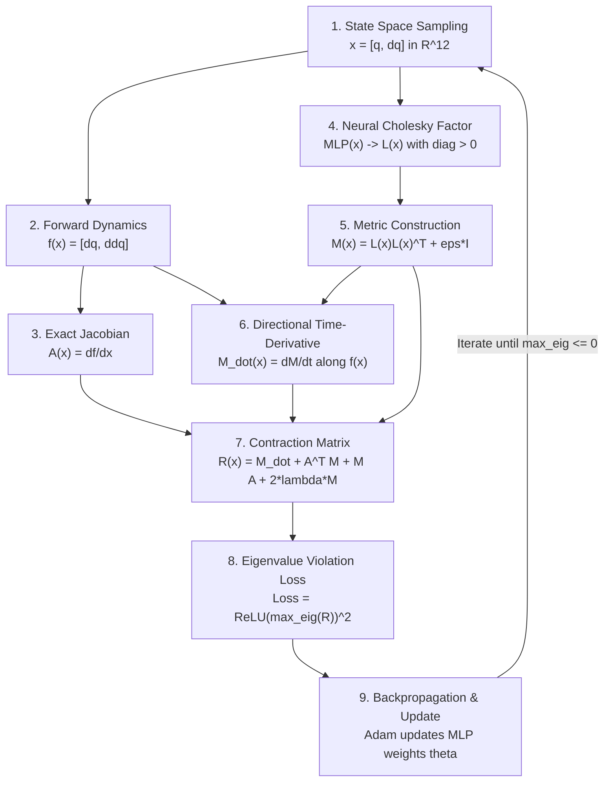

# Neural Contraction Metric (CCM) for SO-101 and Robotic Systems

This module implements **Neural Contraction Metrics** to solve for the Riemannian metric $M(x)$ that satisfies the Contraction Linear Matrix Inequality (LMI):

$$
\dot{M}(x) + A(x)^T M(x) + M(x) A(x) \preceq -2\lambda M(x)
$$

where:
- $x = [q, \dot{q}]^T \in \mathbb{R}^{2n}$ is the system state (12D for the 6-DOF SO-101).
- $A(x) = \frac{\partial f}{\partial x}$ is the Jacobian of the dynamics $\dot{x} = f(x)$.
- $\lambda > 0$ is the guaranteed exponential convergence rate.

---

## Step-by-Step Process: How $M(x)$ Is Found

The computer does not guess or calculate $M(x)$ by hand. It trains a neural network to satisfy the mathematical contraction condition via the following **9-step algorithmic pipeline**:



# Detailed Pipeline Breakdown

### 1. State Space Sampling (\(x\))

Batches of robot states are sampled across the SO-101 joint limits:

\[
x =
\begin{bmatrix}
q_1 & \cdots & q_6 &
\dot{q}_1 & \cdots & \dot{q}_6
\end{bmatrix}^{T}
\in \mathbb{R}^{12}
\]

where \(q_i\) represents the joint position and \(\dot{q}_i\) represents the joint velocity.

### 2. Closed-Loop Robot Dynamics (\(f(x)\))

Given the current joint angles \(q\) and velocities \(\dot{q}\), evaluate the system dynamics:

\[
\dot{x} = f(x)
\]

The closed-loop dynamics are defined as:

\[
\boxed{
\dot{x}
=
\begin{bmatrix}
\dot{q}\\[6pt]
\ddot{q}
\end{bmatrix}
=
\begin{bmatrix}
\dot{q}\\[6pt]
M_{\mathrm{robot}}(q)^{-1}
\left(
\tau(q,\dot{q})
-
C(q,\dot{q})\dot{q}
-
g(q)
\right)
\end{bmatrix}
}
\]

where:

- \(M_{\mathrm{robot}}(q)\) is the robot's inertia matrix.
- \(C(q,\dot{q})\) is the Coriolis and centrifugal matrix.
- \(g(q)\) is the gravity vector.
- \(\tau(q,\dot{q})\) is the closed-loop control torque.

### 3. Jacobian Computation (\(A(x)\))

PyTorch autograd computes the Jacobian of the closed-loop dynamics for every sampled state in the batch:

\[
\boxed{
A(x)
=
\frac{\partial f(x)}{\partial x}
\in \mathbb{R}^{12\times12}
}
\]

This matrix describes the local linearization of the nonlinear dynamics around each sampled state.

### 4. Neural Cholesky Parametrization (\(L(x)\))

A multilayer perceptron (MLP) takes the state vector \(x\in\mathbb{R}^{12}\) as input and predicts the lower-triangular entries of \(L(x)\).

For a \(12\times12\) lower-triangular matrix, the number of independent entries is:

\[
\boxed{
N_L
=
\frac{12(12+1)}{2}
=
78
}
\]

The neural network therefore predicts 78 values.

To ensure strictly positive diagonal elements, the following transformation is applied:

\[
\boxed{
L_{ii}(x)
=
\operatorname{softplus}(l_{ii}(x))
+
\epsilon_{\mathrm{diag}}
}
\]

where:

\[
\operatorname{softplus}(z)
=
\ln(1+e^z)
\]

and \(\epsilon_{\mathrm{diag}}>0\) is a small positive constant.

### 5. Metric Matrix Assembly (\(M(x)\succ0\))

The contraction metric is constructed as:

\[
\boxed{
M(x)
=
L(x)L(x)^T
+
\epsilon I_{12}
}
\]

where:

- \(L(x)\in\mathbb{R}^{12\times12}\) is the learned lower-triangular matrix.
- \(I_{12}\) is the \(12\times12\) identity matrix.
- \(\epsilon>0\) is a small regularization constant.

By construction:

\[
\boxed{
M(x)=M(x)^T\succ0
}
\]

Therefore, the metric matrix is **guaranteed to be symmetric and positive-definite** for every state \(x\), regardless of the neural network weights.

### 6. Directional Time Derivative (\(\dot{M}(x)\))

Along system trajectories, the metric \(M(x(t))\) changes over time.

Using the chain rule:

\[
\boxed{
\dot{M}(x)
=
\sum_{k=1}^{12}
\frac{\partial M(x)}{\partial x_k}
f_k(x)
}
\]

Equivalently:

\[
\dot{M}(x)
=
D M(x)[f(x)]
\]

where \(D M(x)[f(x)]\) denotes the directional derivative of the metric along the system vector field.

This quantity is computed efficiently using PyTorch autograd.

### 7. Contraction Matrix Formation (\(R(x)\))

The differential Lyapunov matrix is assembled as:

\[
\boxed{
R(x)
=
\dot{M}(x)
+
A(x)^T M(x)
+
M(x)A(x)
+
2\lambda M(x)
}
\]

where \(\lambda>0\) is the desired contraction rate.

The contraction condition requires:

\[
\boxed{
R(x)\preceq0
}
\]

or, equivalently:

\[
\boxed{
\lambda_{\max}(R(x))\leq0
}
\]

for all states in the region of interest.

### 8. Eigenvalue Penalty Loss (\(\mathcal{L}_{\mathrm{LMI}}\))

The maximum eigenvalue of \(R(x)\) is computed using:

`torch.linalg.eigvalsh(R)`

The training loss is defined as:

\[
\boxed{
\mathcal{L}
=
\frac{1}{B}
\sum_{k=1}^{B}
\left[
\operatorname{ReLU}
\left(
\lambda_{\max}(R(x_k))
\right)
\right]^2
+
\frac{\beta}{B}
\sum_{k=1}^{B}
\operatorname{Tr}(M(x_k))
}
\]

where:

- \(B\) is the batch size.
- \(\lambda_{\max}(R(x_k))\) is the largest eigenvalue of the contraction matrix.
- \(\operatorname{ReLU}(z)=\max(0,z)\).
- \(\beta\geq0\) is the metric regularization coefficient.
- \(\operatorname{Tr}(M(x_k))\) is the trace of the learned metric.

**Contraction constraint satisfaction:**

If

\[
\lambda_{\max}(R(x_k))\leq0,
\]

then

\[
\mathcal{L}_{\mathrm{LMI}}(x_k)=0.
\]

**Contraction constraint violation:**

If

\[
\lambda_{\max}(R(x_k))>0,
\]

then

\[
\mathcal{L}_{\mathrm{LMI}}(x_k)
=
\left[
\lambda_{\max}(R(x_k))
\right]^2.
\]

The squared penalty encourages the optimizer to reduce positive eigenvalues and satisfy the contraction inequality.

### 9. Optimization Step

The Adam optimizer computes the gradient of the loss with respect to the neural network parameters \(\theta\):

\[
\boxed{
\nabla_{\theta}\mathcal{L}
=
\frac{\partial\mathcal{L}}{\partial\theta}
}
\]

The network parameters are then updated iteratively:

\[
\boxed{
\theta_{t+1}
=
\operatorname{AdamUpdate}
\left(
\theta_t,
\nabla_{\theta}\mathcal{L}
\right)
}
\]

The objective is to learn a state-dependent metric \(M_{\theta}(x)\) satisfying:

\[
\boxed{
\dot{M}_{\theta}(x)
+
A(x)^T M_{\theta}(x)
+
M_{\theta}(x)A(x)
\preceq
-2\lambda M_{\theta}(x)
}
\]

throughout the region of interest.

Once this condition is verified over the entire specified state-space region, the learned metric can serve as a **certified contraction metric** for the closed-loop robot dynamics.

**Important:** Satisfying the contraction inequality at sampled training points alone does not establish a formal global or regional certificate. Formal certification requires additional verification that the inequality holds throughout the specified continuous state-space region.
---

## Benchmark Comparison: Classical SOS vs. Neural CCM

| Dimension | Classical SOS (Drake + MOSEK) | Neural CCM (`neural_ccm.py`) |
| :--- | :--- | :--- |
| **OS Support** | Linux / macOS only (no native Windows) | Runs natively on **Windows, Linux, macOS** |
| **Hardware** | Pure CPU + High RAM (Gigabytes required) | **Laptop CPU friendly** (runs in seconds) & GPU ready |
| **Scaling** | Combinatorial explosion ($\binom{n+d}{d}$). Chokes on 6-DOF ($n=12$). | Scales smoothly to 12D+ state space with an MLP |
| **Speed** | 10+ minutes to hours or Out Of Memory | **17.5 seconds** for 200 epochs on a laptop CPU |
| **Guarantees** | Exact polynomial proof | Empirical certification over sampled state manifold |

---

## 1. Training Commands

### A. 1-DOF Damped Pendulum (Quick Test, ~1 second on CPU)
```bash
python examples/ccm/neural_ccm.py --system pendulum --epochs 150
```
Saved checkpoint: `outputs/ccm/metric_pendulum.pt`

### B. 6-DOF SO-101 Arm (12D State Space, ~17 seconds on CPU)
```bash
python examples/ccm/neural_ccm.py --system so101 --epochs 250 --batch-size 64
```
Saved checkpoint: `outputs/ccm/metric_so101.pt`

---

## 2. Inspecting & Evaluating Results

Use `examples/ccm/eval_ccm.py` to evaluate any trained checkpoint:

```bash
# Evaluate SO-101 Arm Metric:
python examples/ccm/eval_ccm.py --checkpoint outputs/ccm/metric_so101.pt

# Evaluate Pendulum Metric:
python examples/ccm/eval_ccm.py --checkpoint outputs/ccm/metric_pendulum.pt
```

### What `eval_ccm.py` Reports:

1. **Strict Positive Definiteness Check ($M(x) \succ 0$):**
   - Confirms $\lambda_{\min}(M(x)) > 0$ across thousands of unseen test states.
   - Reports condition number $\kappa(M(x)) = \frac{\lambda_{\max}(M)}{\lambda_{\min}(M)}$ to ensure numerical stability.

2. **Contraction Condition Check ($R(x) \preceq 0$):**
   - Calculates maximum eigenvalue of $R(x)$. When $\lambda_{\max}(R) \le 0$, trajectories are certified to contract exponentially.

3. **Riemannian Distance Simulation:**
   - Starts two neighboring trajectories $x_1(t)$ and $x_2(t)$.
   - Computes Riemannian distance:
   
     $$
     d_M(t) = \sqrt{\delta x(t)^T M(x_1(t)) \delta x(t)}
     $$
     
   - Confirms exponential convergence towards zero ($d_M(t) \le d_M(0) e^{-\lambda t}$).

4. **Matrix Inspection:**
   - Displays the actual numeric values of the learned $12 \times 12$ matrix $M(x)$ at nominal robot configurations.
