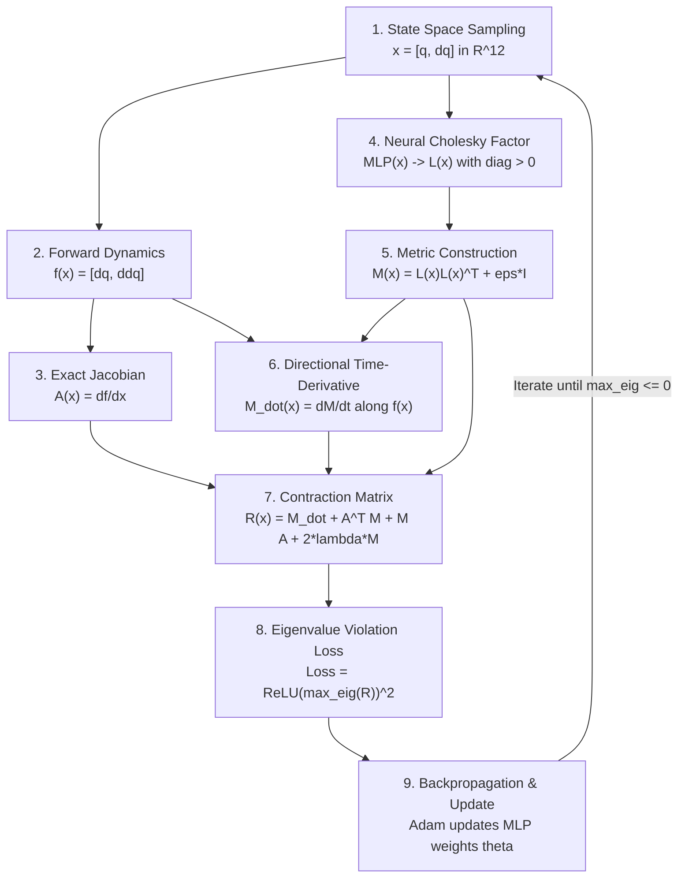

# Neural Contraction Metric (CCM) for SO-101 and Robotic Systems

This module implements **Neural Contraction Metrics** to solve for the Riemannian metric $M(x)$ that satisfies the Contraction Linear Matrix Inequality (LMI):

$$
\dot{M}(x) + A(x)^T M(x) + M(x) A(x) \preceq -2\lambda M(x)
$$

where:
- $x = [q, \dot{q}]^T \in \mathbb{R}^{2n}$ is the system state (12D for the 6-DOF SO-101).
- $A(x) = \frac{\partial f}{\partial x}$ is the Jacobian of the dynamics $\dot{x} = f(x)$.
- $\lambda > 0$ is the guaranteed exponential convergence rate.

---

## Step-by-Step Process: How $M(x)$ Is Found

The computer does not guess or calculate $M(x)$ by hand. It trains a neural network to satisfy the mathematical contraction condition via the following **9-step algorithmic pipeline**:



### Detailed Pipeline Breakdown:

1. **State Space Sampling ($x$):**  
   Batches of robot states are sampled across the SO-101 joint limits:
   
   $$
   x = [q_1, \dots, q_6, \dot{q}_1, \dots, \dot{q}_6]^T \in \mathbb{R}^{12}
   $$

2. **Closed-Loop Robot Dynamics ($f(x)$):**  
   Given current joint angles $q$ and velocities $\dot{q}$, evaluate the system dynamics $\dot{x} = f(x)$:
   
   $$
   \dot{x} = \begin{bmatrix} \dot{q} \\ \ddot{q} \end{bmatrix} = \begin{bmatrix} \dot{q} \\ M_{\text{robot}}(q)^{-1}\big(\tau(q, \dot{q}) - C(q, \dot{q})\dot{q} - g(q)\big) \end{bmatrix}
   $$

3. **Jacobian Computation ($A(x)$):**  
   PyTorch autograd computes the exact Jacobian for every sampled state in the batch:
   
   $$
   A(x) = \frac{\partial f}{\partial x} \in \mathbb{R}^{12 \times 12}
   $$

4. **Neural Cholesky Parametrization ($L(x)$):**  
   An MLP takes $x \in \mathbb{R}^{12}$ and predicts the $\frac{12 \times 13}{2} = 78$ lower-triangular entries of $L(x)$. Positive diagonal elements are strictly enforced using:
   
   $$
   L_{ii}(x) = \text{softplus}(l_{ii}) + \epsilon_{\text{diag}}
   $$

5. **Metric Matrix Assembly ($M(x) \succ 0$):**  
   
   $$
   M(x) = L(x) L(x)^T + \epsilon I
   $$
   
   By the Cholesky factorization theorem, $M(x)$ is **guaranteed to be symmetric and positive-definite** everywhere for any network weights.

6. **Directional Time-Derivative ($\dot{M}(x)$):**  
   Along system trajectories, $M(x(t))$ changes over time. Using the chain rule:
   
   $$
   \dot{M}(x) = \sum_{k=1}^{12} \frac{\partial M(x)}{\partial x_k} f_k(x)
   $$
   
   This is computed efficiently via autograd directional derivatives along the vector field $f(x)$.

7. **Contraction Matrix Formation ($R(x)$):**  
   Assemble the differential Lyapunov matrix:
   
   $$
   R(x) = \dot{M}(x) + A(x)^T M(x) + M(x) A(x) + 2\lambda M(x)
   $$

8. **Eigenvalue Penalty Loss ($\mathcal{L}_{\text{LMI}}$):**  
   Compute the maximum eigenvalue $\lambda_{\max}(R(x))$ using `torch.linalg.eigvalsh(R)`:
   
   $$
   \mathcal{L} = \frac{1}{B} \sum_{k=1}^B \text{ReLU}\big(\lambda_{\max}(R(x_k))\big)^2 + \beta \text{Tr}(M(x_k))
   $$
   
   - If $\lambda_{\max}(R) \le 0$, the contraction constraint is satisfied and penalty is $0$.
   - If $\lambda_{\max}(R) > 0$, the penalty squares the violation to drive it below $0$.

9. **Optimization Step:**  
   Adam computes $\nabla_\theta \mathcal{L}$ with respect to the MLP weights $\theta$ and updates the network. Once $\lambda_{\max}(R) \le 0$ across the state space, the neural network becomes the certified contraction metric $M(x)$.

---

## Benchmark Comparison: Classical SOS vs. Neural CCM

| Dimension | Classical SOS (Drake + MOSEK) | Neural CCM (`neural_ccm.py`) |
| :--- | :--- | :--- |
| **OS Support** | Linux / macOS only (no native Windows) | Runs natively on **Windows, Linux, macOS** |
| **Hardware** | Pure CPU + High RAM (Gigabytes required) | **Laptop CPU friendly** (runs in seconds) & GPU ready |
| **Scaling** | Combinatorial explosion ($\binom{n+d}{d}$). Chokes on 6-DOF ($n=12$). | Scales smoothly to 12D+ state space with an MLP |
| **Speed** | 10+ minutes to hours or Out Of Memory | **17.5 seconds** for 200 epochs on a laptop CPU |
| **Guarantees** | Exact polynomial proof | Empirical certification over sampled state manifold |

---

## 1. Training Commands

### A. 1-DOF Damped Pendulum (Quick Test, ~1 second on CPU)
```bash
python examples/ccm/neural_ccm.py --system pendulum --epochs 150
```
Saved checkpoint: `outputs/ccm/metric_pendulum.pt`

### B. 6-DOF SO-101 Arm (12D State Space, ~17 seconds on CPU)
```bash
python examples/ccm/neural_ccm.py --system so101 --epochs 250 --batch-size 64
```
Saved checkpoint: `outputs/ccm/metric_so101.pt`

---

## 2. Inspecting & Evaluating Results

Use `examples/ccm/eval_ccm.py` to evaluate any trained checkpoint:

```bash
# Evaluate SO-101 Arm Metric:
python examples/ccm/eval_ccm.py --checkpoint outputs/ccm/metric_so101.pt

# Evaluate Pendulum Metric:
python examples/ccm/eval_ccm.py --checkpoint outputs/ccm/metric_pendulum.pt
```

### What `eval_ccm.py` Reports:

1. **Strict Positive Definiteness Check ($M(x) \succ 0$):**
   - Confirms $\lambda_{\min}(M(x)) > 0$ across thousands of unseen test states.
   - Reports condition number $\kappa(M(x)) = \frac{\lambda_{\max}(M)}{\lambda_{\min}(M)}$ to ensure numerical stability.

2. **Contraction Condition Check ($R(x) \preceq 0$):**
   - Calculates maximum eigenvalue of $R(x)$. When $\lambda_{\max}(R) \le 0$, trajectories are certified to contract exponentially.

3. **Riemannian Distance Simulation:**
   - Starts two neighboring trajectories $x_1(t)$ and $x_2(t)$.
   - Computes Riemannian distance:
   
     $$
     d_M(t) = \sqrt{\delta x(t)^T M(x_1(t)) \delta x(t)}
     $$
     
   - Confirms exponential convergence towards zero ($d_M(t) \le d_M(0) e^{-\lambda t}$).

4. **Matrix Inspection:**
   - Displays the actual numeric values of the learned $12 \times 12$ matrix $M(x)$ at nominal robot configurations.
