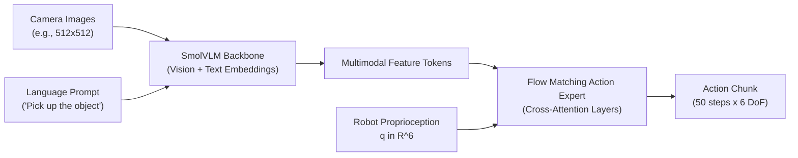

# SmolVLA: Compact Vision-Language-Action Policy

This module documents and provides workflows for **SmolVLA**, a lightweight Vision-Language-Action (VLA) model designed for efficient, affordable robotic manipulation with natural language task conditioning.

Implementation: [`src/lerobot/policies/smolvla/`](../../src/lerobot/policies/smolvla/)

---

## 🧠 Architecture Overview

SmolVLA combines a compact Vision-Language Model (VLM) backbone with an expressive flow-matching action expert:



1. **VLM Backbone ([`smolvlm_with_expert.py`](../../src/lerobot/policies/smolvla/smolvlm_with_expert.py))**:
   - Ingests RGB camera stream(s) alongside natural language task commands (`observation.images.*`, language prompt).
   - Generates contextual multimodal token embeddings.
2. **Action Expert & Flow Matching ([`modeling_smolvla.py`](../../src/lerobot/policies/smolvla/modeling_smolvla.py))**:
   - Uses cross-attention into VLM token representations.
   - Flow matching vector field generates continuous action trajectory chunks (default chunk size: 50).
   - Adapts to robot proprioception with padding up to 32 dimensions (`max_state_dim`, `max_action_dim`).

---

## 🏋️ Training SmolVLA on SO-101

To train a SmolVLA policy on the demonstration dataset:

```bash
lerobot-train \
    --dataset.repo_id=huitaehan/so101_demo \
    --policy.type=smolvla \
    --output_dir=outputs/train/smolvla_so101 \
    --job_name=smolvla_so101 \
    --batch_size=8 \
    --steps=20000 \
    --wandb.enable=false
```

### Key Hyperparameters ([`configuration_smolvla.py`](../../src/lerobot/policies/smolvla/configuration_smolvla.py))

- `n_action_steps`: `50` (action chunk prediction horizon)
- `resize_imgs_with_padding`: `(512, 512)`
- `tokenizer_max_length`: `48` tokens
- `vlm_model_name`: Pretrained SmolVLM base model
- `use_delta_joint_actions_aloha`: Joint delta or absolute setpoint toggle

---

## 🤖 Evaluation & Deployment on SO-101

Once trained, deploy the SmolVLA checkpoint to control the physical SO-101 follower arm:

```powershell
lerobot-record `
    --robot.type=so101_follower `
    --robot.port=COM6 `
    --robot.id=my_follower_arm `
    --robot.cameras="{top: {type: opencv, index_or_path: 1, width: 640, height: 480, fps: 30}}" `
    --dataset.repo_id=huitaehan/eval_smolvla_so101 `
    --dataset.single_task="Pick the object and place it" `
    --dataset.num_episodes=5 `
    --policy.path=outputs/train/smolvla_so101/checkpoints/last/pretrained_model `
    --display_data=false `
    --play_sounds=false
```

To stress-test SmolVLA under perturbations, evaluate using the safety module:

```powershell
python examples/safety/robust_safety_so101_eval.py `
    --policy-path outputs/train/smolvla_so101/checkpoints/last/pretrained_model `
    --port COM6 `
    --camera-index 1 `
    --episodes 5 `
    --perturb-enabled true
```
