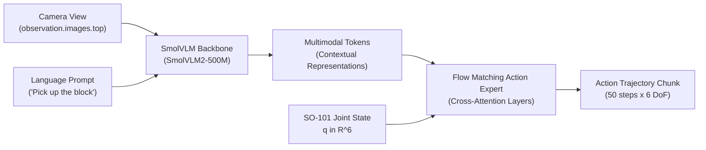

# SmolVLA: Compact Vision-Language-Action Policy

This module documents and provides workflows for **SmolVLA**, a lightweight Vision-Language-Action (VLA) foundation model designed for efficient, affordable robotic manipulation with natural language task conditioning on the **SO-101 6-DoF robotic arm**.

- **Core Implementation**: [`src/lerobot/policies/smolvla/`](../../src/lerobot/policies/smolvla/)
- **Target Hardware**: SO-101 Follower Arm (`COM8`), Top Camera (`index=1`, 640x480 @ 30 FPS)
- **Pretrained Checkpoint**: [`lerobot/smolvla_base`](https://huggingface.co/lerobot/smolvla_base) (450M parameters)
- **Demonstration Dataset**: [`huitaehan/so101_demo`](https://huggingface.co/datasets/huitaehan/so101_demo) (48 episodes, *"Pick the object and place it"*)

---

## 🧠 Architecture Overview

SmolVLA couples a compact Vision-Language Model (VLM) backbone with an expressive flow-matching action expert:



1. **VLM Backbone ([`smolvlm_with_expert.py`](../../src/lerobot/policies/smolvla/smolvlm_with_expert.py))**:
   - Ingests RGB camera stream(s) alongside natural language task commands (`observation.images.*`, language prompt).
   - Generates contextual multimodal token embeddings.
2. **Action Expert & Flow Matching ([`modeling_smolvla.py`](../../src/lerobot/policies/smolvla/modeling_smolvla.py))**:
   - Uses cross-attention into VLM token representations.
   - Flow matching vector field generates continuous action trajectory chunks (default chunk size: 50).
   - Adapts to robot proprioception with padding up to 32 dimensions (`max_state_dim`, `max_action_dim`).

---

## 🛠️ Recent Fixes & Compatibility (PyTorch 2.11+)

The codebase includes specific compatibility patches for PyTorch 2.11+ and Transformers 5.x:
- **Boolean Mask Constraint**: PyTorch 2.11 enforces that `torch.where(condition, x, y)` strictly requires a boolean condition. In [`smolvlm_with_expert.py`](../../src/lerobot/policies/smolvla/smolvlm_with_expert.py#L560), attention masks are explicitly cast with `.bool()`.
- **Language Mask Type Preservation**: Language attention masks from Hugging Face tokenizers (`int64`) are cast to `bool` in [`modeling_smolvla.py`](../../src/lerobot/policies/smolvla/modeling_smolvla.py#L616) and [`vla_utils.py`](../../src/lerobot/policies/common/vla_utils.py#L89) to prevent unintended tensor promotion to `Long`.

---

## 🧪 Step 0: Dry-Run Verification (Completed [✓])

Validate dependencies, model architecture, tensor shapes, and loss/inference passes on CPU without needing hardware connected:

```powershell
python examples/smolvla/verify_smolvla.py --batch-size 2 --chunk-size 50 --num-steps 5
```

**Verification Results:**
- ✅ **Backbone & Expert initialized**: ~360M VLM Backbone + ~90M Action Expert (450M total).
- ✅ **Synthetic SO-101 Batch**: 6-DoF joint state, 6-DoF action chunks, top camera images (`480x640`).
- ✅ **Flow Matching Loss Pass**: Clean gradient flow and loss computation.
- ✅ **Inference Pass**: 50-step receding-horizon action chunk prediction and FIFO queue handling.

---

## 🚀 How to Post-Train (Fine-Tune) from Current Point

SmolVLA is a **pretrained base foundation model** (`lerobot/smolvla_base`). You do **not** train from scratch; you only perform **post-training (fine-tuning / adaptation)** on your SO-101 demonstrations.

### Phase 1: Verify Demonstration Dataset
Inspect your existing dataset metadata to ensure all modalities match the policy:

```powershell
python inspect_dataset.py
```
Expected output:
- **Repo ID**: `huitaehan/so101_demo`
- **Features**: `observation.images.top` (480, 640, 3), `observation.state` (6,), `action` (6,)
- **Episodes**: 48 demonstrations

---

### Phase 2: Run Post-Training (Fine-Tuning)

#### Option A: Fast / Action-Expert Only (Recommended)
Freezes the SmolVLM vision encoder and only updates the ~90M Action Expert and projection layers. This trains fast, uses significantly less VRAM (~6–8 GB), and prevents catastrophic forgetting of language understanding:

```powershell
python src/lerobot/scripts/lerobot_train.py `
    --policy.path=lerobot/smolvla_base `
    --dataset.repo_id=huitaehan/so101_demo `
    --output_dir=outputs/train/smolvla_so101_expert `
    --job_name=smolvla_so101_expert `
    --batch_size=16 `
    --steps=20000 `
    --policy.freeze_vision_encoder=true `
    --policy.train_expert_only=true `
    --policy.device=cuda `
    --wandb.enable=false
```

#### Option B: Full Fine-Tuning
Fine-tunes both the SmolVLM vision backbone and the Action Expert (requires an NVIDIA GPU with $\ge$16 GB VRAM or Google Colab A100):

```powershell
python src/lerobot/scripts/lerobot_train.py `
    --policy.path=lerobot/smolvla_base `
    --dataset.repo_id=huitaehan/so101_demo `
    --output_dir=outputs/train/smolvla_so101_full `
    --job_name=smolvla_so101_full `
    --batch_size=8 `
    --steps=20000 `
    --policy.freeze_vision_encoder=false `
    --policy.train_expert_only=false `
    --policy.device=cuda `
    --wandb.enable=false
```

> [!TIP]
> **No Local GPU?**
> You can train on Google Colab for free or low cost:
> 1. Open the [SmolVLA Colab Notebook](https://colab.research.google.com/github/huggingface/notebooks/blob/main/lerobot/training-smolvla.ipynb).
> 2. Set `--dataset.repo_id=huitaehan/so101_demo` and `--policy.path=lerobot/smolvla_base`.
> 3. Download the resulting checkpoint folder into `outputs/train/smolvla_so101/`.

---

## ⚡ Testing Pretrained Base Weights on Hardware (Zero-Shot Trial)

Can you test the un-finetuned `lerobot/smolvla_base` directly on the physical SO-101 arm? **Yes, for communication and pipeline validation.**

A dedicated script is available in [`examples/tutorial/smolvla/using_smolvla_example.py`](../../examples/tutorial/smolvla/using_smolvla_example.py).

### Safety Checklist Before Running:
> [!CAUTION]
> Because `lerobot/smolvla_base` was trained on different camera mounts and table heights, its zero-shot action predictions will not be millimeter-accurate to your desk.
> 1. **Clear the workspace**: Ensure no fragile objects or obstacles are within the arm's reach.
> 2. **Emergency Disconnect**: Keep one hand on the USB cable or power supply.
> 3. **Elevate or Free-Space Test**: Place the arm where it cannot collide with the desk surface during initial motions.

### Running the Live Hardware Test:

1. Confirm your COM ports:
   ```powershell
   python -m serial.tools.list_ports
   ```
2. Run the policy streaming script:
   ```powershell
   python examples/tutorial/smolvla/using_smolvla_example.py
   ```

---

## 🤖 Real-World Deployment & Evaluation (Post-Trained Model)

Once post-training finishes, evaluate the model on the physical arm:

```powershell
python src/lerobot/scripts/lerobot_record.py `
    --robot.type=so101_follower `
    --robot.port=COM6 `
    --robot.id=my_follower_arm `
    --robot.cameras="{top: {type: opencv, index_or_path: 1, width: 640, height: 480, fps: 30}}" `
    --dataset.repo_id=huitaehan/eval_smolvla_so101 `
    --dataset.single_task="Pick the object and place it" `
    --dataset.num_episodes=10 `
    --policy.path=outputs/train/smolvla_so101_expert/checkpoints/last/pretrained_model `
    --display_data=true
```

---

## 🛡️ Implicit Contraction Layers (ICL) & Safety Shields

To guarantee the arm never exceeds motor velocity, acceleration, or workspace safety limits during VLA execution, wrap SmolVLA's outputs through the safety filters:

- **Control Barrier Function (CBF)**: [`examples/safety/robust_safety_so101_eval.py`](../safety/robust_safety_so101_eval.py)
- **Neural Contraction Metrics (CCM)**: [`examples/ccm/README.md`](../ccm/README.md)
- **Implicit Contraction Layers (ICL)**: [`../../implicit_contraction_layers/`](../../implicit_contraction_layers/)

---

### 🔬 Implicit Contraction Layer (ICL) Workflow

Integrates **"Robust Reinforcement Learning-based Trajectory Tracking through Implicit Contraction Layers"** (*Kim, Han, Sreenath, 2027*). SmolVLA proposes high-level 5-DoF / 6-DoF joint actions, and the differentiable QP layer projects them to guarantee exponential disturbance attenuation ($\rho = 0.98, R = I_5$).

#### Files in this Module:

| Script / File | Path | Purpose |
| :--- | :--- | :--- |
| **SmolVLA Adapter** | [`src/lerobot/policies/smolvla/adapter_icl.py`](../../src/lerobot/policies/smolvla/adapter_icl.py) | Bridges SmolVLA with ICL: bounds checking, observation formatting, 5-DoF slicing, and discrete gripper handling. |
| **Sanity Check** | [`test_smolvla_icl_integration.py`](test_smolvla_icl_integration.py) | CPU-only verification that `SmolVLAAdapter` and `SafeBoxHalfspaceQP` are unified and properly projecting actions. |
| **Simulation Testbed** | [`simulate_smolvla_icl.py`](simulate_smolvla_icl.py) | Closed-loop simulator with live 3D OpenGL window (`--render`) and MP4 recording (`--save-video`). |
| **Paper Benchmark** | [`evaluate_so101_paper_pipeline.py`](evaluate_so101_paper_pipeline.py) | Replicates Table 1 metrics (Recovery %, Fallback %, $t_{95}$ latency, peak error) on sim and real hardware. |
| **5-DoF SO-101 Task** | [`implicit_contraction_layers/src/icl_core/so101.py`](../../implicit_contraction_layers/src/icl_core/so101.py) | 5-DoF environment matching paper Appendix B ($dq = [0.25, 0.25, 0.25, 0.25, 0.35]\text{ rad}$). |
| **Experiment Config** | [`implicit_contraction_layers/experiments/so101_reach/config.yaml`](../../implicit_contraction_layers/experiments/so101_reach/config.yaml) | Table 2 configuration: $\rho=0.98, R=I_5, \underline{m}=0.05, \bar{m}=15.25$. |

#### Runnable Commands:

```powershell
# 1. Test adapter + QP layer unification (Pure CPU):
python examples/smolvla/test_smolvla_icl_integration.py

# 2. Interactive 3D simulation with live window:
python examples/smolvla/simulate_smolvla_icl.py --env reacher --render --steps 200

# 3. Export simulation video to MP4:
python examples/smolvla/simulate_smolvla_icl.py --env reacher --save-video --steps 100

# 4. Run Table 1 paper disturbance benchmark:
python examples/smolvla/evaluate_so101_paper_pipeline.py --task reach --episodes 5
python examples/smolvla/evaluate_so101_paper_pipeline.py --task carry --episodes 5

# 5. Evaluate with learned layer/best.pt:
python examples/smolvla/evaluate_so101_paper_pipeline.py --checkpoint path/to/layer/best.pt

# 6. Deploy to real SO-101 robot arm:
python examples/smolvla/evaluate_so101_paper_pipeline.py --mode hardware --port COM3
```
